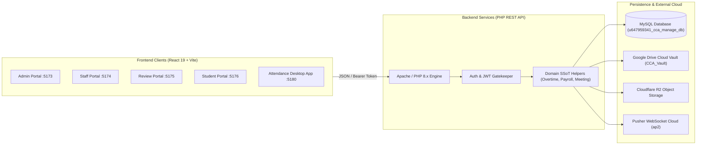
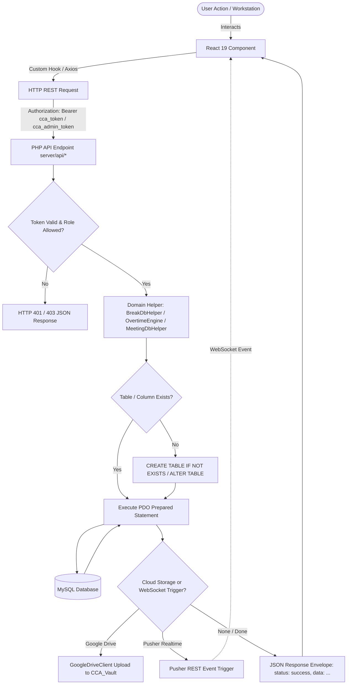
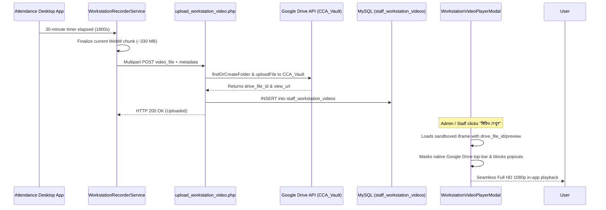

# 🏛️ Creative Computer Academy (CCA) — Master Architectural Blueprint

**Generated / Updated:** November 26, 2026  
**Role:** Lead Software Architect & Senior Full-Stack Engineer  
**Scope:** Full Workspace (`CreateiveComputerAcademy`) — 4 React 19 Web Frontends, 2 Electron Desktop Apps, 1 Plain PHP REST API (429 endpoints across 34 domains), 96 baseline MySQL tables + self-healing JIT schemas, WebRTC Live Video Conferencing & Virtual Background Studio, Workstation 30-Min Video Surveillance & In-App Shielded Vault Player, Single Source of Truth (SSoT) Overtime & Payroll Ledger Engines, Inactivity Watchdog, and Multi-Tier Storage Routing.

No application code or database schemas were modified, deleted, or refactored to produce this document. All statements are traced directly from the active code in this repository as of the current working tree. Anything not directly verifiable is marked `UNKNOWN — insufficient evidence in the provided codebase.`

---

# 1. PROJECT UNDERSTANDING STATUS

**Status: FULL CODEBASE EXHAUSTIVELY ANALYZED & VERIFIED.**

The entire repository has been mapped and verified across every tier:
* **4 Frontend Web Portals**:
  1. `admin-frontend` (Port 5173): Core operational & managerial headquarters (39 pages, React 19 + Tailwind v3, Vite 8.2).
  2. `staff-frontend` (Port 5174): Staff workstation, attendance, break management, payroll wallet, developer console (40 pages, React 19 + Tailwind v4, Vite 8.2).
  3. `review-frontend` (Port 5175): QA assessment portal for student and staff submissions (15 pages, React 19 + TypeScript).
  4. `student-frontend` (Port 5176): Student LMS, interactive typing lab & Bezier PenTool training (16 pages, React 19 + Tailwind v4).
* **2 Desktop Workstation Applications**:
  1. `Staff_Apps/Attendance-Desktop` (Port 5180 dev / Electron 35): Staff attendance, WebRTC peer screen streaming, native input injection (`input_injector.exe`), 30-minute surveillance video recording with encrypted offline punch queue (`WorkstationRecorderService.js`).
  2. `Admin_Apps/Admin-Desktop` (Port 5185 dev / Electron): Executive station with system telemetry and headless browser integration.
* **Backend API Tier**:
  * 429 PHP endpoints in `server/api/` across 34 business domains.
  * Zero external framework, raw procedural architecture, PDO database connectivity with Asia/Dhaka (`+06:00`) timezone pinning.
* **Database Layer**:
  * 96 baseline tables in `server/u647959341_cca_manage_db (4).sql`.
  * Dynamic self-healing JIT schemas for runtime table creation (`staff_workstation_videos`, `staff_idle_alerts`, `staff_heartbeats`, `system_storage_settings`, `academy_meetings`, `event_participants`, etc.).
* **Third-Party Integrations**:
  * Pusher WebSockets (`ap2` cluster), Google Drive API Cloud Vault (`CCA_Vault`), Cloudflare R2 object storage, MediaPipe AI Segmentation for camera virtual backgrounds, Google Gemini REST API.

---

# 2. TECHNOLOGY STACK

### Core Technologies:
1. **Frontend**: React 19.2.8, React Router DOM v7, Vite 8.2, Tailwind CSS (v3 in Admin/Review, v4 in Staff/Student/Desktop), `sonner`, `react-icons/fi`, `recharts`, `framer-motion`.
2. **Desktop**: Electron v35.0.0, Node.js, `input_injector.exe` (Win32 API child process).
3. **Backend**: Plain PHP 8.x (no framework overhead), PDO with prepared statements, cURL, JSON REST.
4. **Database**: MySQL / MariaDB (InnoDB, `utf8mb4_unicode_ci`, Asia/Dhaka UTC+6).
5. **Realtime**: WebSockets via Pusher (`pusher-js` & `PusherHelper.php`), WebRTC Peer-to-Peer (`RTCPeerConnection`).

---

# 3. ARCHITECTURE SUMMARY

The CCA architecture operates on a strict stateless REST design paired with reactive realtime websockets and peer-to-peer WebRTC streams.

---

# 4. COMPLETE MODULE LIST

| # | Module Name | Primary Frontend | Primary Backend Directory | Key Capabilities |
|---|---|---|---|---|
| 1 | **Workstation Surveillance Video Vault** | `admin-frontend`, `staff-frontend`, `Staff_Apps` | `server/api/screen_monitor/` | 30-min continuous WebM recording, local spooling, auto-sync to Google Drive `CCA_Vault`, in-app shielded video player with popout blocking. |
| 2 | **Inactivity Watchdog & Idle Alerts** | `Staff_Apps`, `admin-frontend`, `staff-frontend` | `server/api/screen_monitor/` | 5-minute mouse/keyboard freeze detection via Electron & input injector, idle alert logging, live active window & app telemetry. |
| 3 | **Live Video Conference Studio** | `admin-frontend`, `staff-frontend` | `server/api/meetings/` | WebRTC multi-peer conference, host/co-host hierarchy, MediaPipe AI background blur & CCA virtual office backgrounds, tab audio mixing recorder. |
| 4 | **Single Source of Truth (SSoT) Overtime** | `staff-frontend`, `admin-frontend` | `server/api/payroll/` | `OvertimeEngine.php`: running cash, shortfall compensation, mango bank harmonization, and automatic cycle adjustments. |
| 5 | **Modular Payroll Ledger Engine** | `admin-frontend`, `staff-frontend` | `server/api/payroll/` | `PayrollLedger.php`: multi-cycle chronological allocation, fractional rollover, salary withdrawal approvals, bonus & penalty logging. |
| 6 | **Mango Break Tree & Simulation** | `staff-frontend`, `Staff_Apps` | `server/api/breaks/` | Gamified break requests, boy mascot with interactive harvest basket, 15m/30m/45m break tracking, automated double-deduction immunity. |
| 7 | **Real-Time Remote Control & Monitoring** | `admin-frontend`, `Staff_Apps` | `server/api/screen_monitor/` | Low-latency WebRTC screen broadcast, live cursor coordinate tracking, and native Windows input injection (`input_injector.exe`). |
| 8 | **Gamification & Career Badges** | `staff-frontend`, `review-frontend` | `server/api/credits/`, `server/api/gamification/` | Double-entry idempotent credit ledger, tier progression, career milestones, review bonus/penalty issuance. |
| 9 | **Attendance & Geofencing Security** | `staff-frontend`, `Staff_Apps`, `admin-frontend` | `server/api/attendance/` | Dynamic office IP matching, proxy/VPN header detection, hardware device fingerprinting, and encrypted offline punch queue. |
| 10 | **Student Academic Leave Quotas** | `staff-frontend`, `admin-frontend`, `student-frontend` | `server/api/leave/` | Course-based leave day quotas, medical slip verification, and automatic class attendance exclusion. |
| 11 | **Developer Console & In-Browser IDE** | `admin-frontend`, `staff-frontend` | `server/api/developer/` | Live log streaming, API test runner, in-browser file manager and code editor with syntax highlighting. |
| 12 | **Fleet Governance & Auto-Updates** | `admin-frontend`, `Staff_Apps` | `server/api/app_releases/` | Version manifest distribution, forced update enforcement, hash verification, standalone and setup installer delivery. |

---

# 5. DATABASE SUMMARY

The database contains 96 baseline tables and 10 self-healing JIT schemas:

### Core Tables & Relationships:
* `users`: Core identity entity (roles: `developer`, `admin`, `staff`, `student`, `reviewer`).
* `staff_attendance`: Check-in/check-out punch records, punch methods, IP hashes, and hours worked.
* `staff_workstation_videos`: 30-minute surveillance video clips, chunk indexes, durations, file sizes, and Google Drive file IDs.
* `staff_idle_alerts`: Inactivity alerts, active window titles, process names, and acknowledgement logs.
* `staff_heartbeats`: Real-time workstation telemetry (ping, idle status, active application).
* `academy_meetings`: Live meeting sessions, room IDs, host IDs, status (`live`, `ended`), and settings.
* `meeting_attendance_logs`: Participant join/leave timestamps, total minutes, and participant tiers.
* `payroll_ledgers`: Detailed double-entry financial transaction logs for staff salaries and advances.
* `system_storage_settings`: Dynamic storage configuration (Google Drive OAuth tokens, root folder IDs, R2 credentials).

---

# 6. AUTHENTICATION & AUTHORIZATION

### Token Standards:
* **Storage**: LocalStorage keys `cca_token` (Staff, Student, Reviewer) and `cca_admin_token` (Admin / Developer).
* **Helper**: `getAuthToken()` checks `cca_token || cca_admin_token` ensuring seamless interoperability in shared components.
* **Header**: Sent as `Authorization: Bearer <TOKEN>` or `?token=<TOKEN>` in GET queries where headers are restricted (e.g. video streams).

### Role Hierarchy:
1. `developer` (Superuser): Equal or superior to admin; full access to all endpoints, tools, and developer consoles.
2. `admin`: Full management access across students, staff, payroll, settings, and fleet.
3. `staff`: Access to personal workstation, attendance, breaks, payroll wallet, and student management.
4. `reviewer`: Access to student submission evaluations, grading, and credit awards.
5. `student`: Access to personal learning modules, progress tracking, and typing lab.

---

# 7. API SUMMARY & MAP (HIGHLIGHTS)

| Domain | Endpoint Path | Method | Auth | Description |
|---|---|---|---|---|
| **Screen Monitor** | `/api/screen_monitor/get_workstation_videos.php` | GET | Token | Retrieves 30-min video logs for selected date, grouped by staff with embedded streaming URLs. |
| **Screen Monitor** | `/api/screen_monitor/get_my_workstation_logs.php` | GET | Token | Retrieves logged-in staff's personal video clips and idle alert history. |
| **Screen Monitor** | `/api/screen_monitor/upload_workstation_video.php` | POST | Token | Receives 30-min WebM chunks from desktop app and uploads directly to Google Drive `CCA_Vault`. |
| **Meetings** | `/api/meetings/get_room.php` | GET | Token | Fetches meeting status, active host tiers, and settings. |
| **Meetings** | `/api/meetings/signal.php` | POST | Token | WebRTC signaling exchange (SDP offer/answer and ICE candidates). |
| **Meetings** | `/api/meetings/upload_recording_drive.php` | POST | Token | Uploads recorded conference composite video directly to Google Drive. |
| **Payroll** | `/api/payroll/get_my_wallet.php` | GET | Token | Fetches live wallet balance, overtime earnings, and cycle stats via `OvertimeEngine` & `PayrollLedger`. |
| **Breaks** | `/api/breaks/request_break.php` | POST | Token | Validates break allowance, logs break request, and updates live status. |
| **Attendance** | `/api/attendance/punch.php` | POST | Token | Processes check-in/check-out with IP geofencing and device validation. |

---

# 8. IMPORTANT DATA FLOWS

### Surveillance Video Ingestion & Playback Pipeline:

---

# 9. FEATURE INVENTORY (RECENT ADDITIONS)

| Feature | Frontend | Backend | API | Database | Status | Key Files |
|---|---|---|---|---|---|---|
| **In-App Video Vault Player** | `admin-frontend`, `staff-frontend`, `Staff_Apps` | `server/api/screen_monitor/` | `get_workstation_videos.php` | `staff_workstation_videos` | **Production Ready** | `WorkstationVideoPlayerModal.jsx`, `WorkstationVideoLogs.jsx`, `MyWorkstation.jsx` |
| **Meeting Virtual Background** | `admin-frontend`, `staff-frontend` | `server/api/meetings/` | `get_room.php`, `signal.php` | `academy_meetings` | **Production Ready** | `useVirtualBackground.js`, `MeetingVirtualBackgroundModal.jsx`, `MeetingStage.jsx` |
| **Modal Root Portals** | `Staff_Apps/Attendance-Desktop` | N/A | N/A | N/A | **Production Ready** | `VideoSpoolModal.jsx`, `AttendanceHistoryModal.jsx`, `DesktopSidebar.jsx` |
| **Hardened Drive Credentials** | N/A | `server/config/`, `server/api/meetings/` | `upload_recording_drive.php` | `system_storage_settings` | **Production Ready** | `GoogleDriveClient.php`, `google_drive_credentials.json` |

---

# 10. EXISTING ISSUES & TECHNICAL DEBT

1. **Browser Single-Camera Access Limit in Windows:**
   * When multiple tabs (`Admin` and `Staff`) run meetings concurrently on the same machine, Windows locks the webcam exclusively to one tab, causing `TrackStartError` / fallback black frames on the other tab.
2. **Vite Minification Chunk Size Warnings:**
   * In `admin-frontend` and `Staff_Apps`, some vendor chunks exceed 500 kB (e.g. `recharts`, `jodit-react`, `lucide-react`). Recommend manual rollup code-splitting for further optimization.

---

# 11. CRITICAL FILES

1. `server/config/GoogleDriveClient.php`: Cloud storage engine managing all Google Drive authentication, folder creation, and file transfers.
2. `server/api/payroll/OvertimeEngine.php`: Single Source of Truth for all overtime and salary calculations.
3. `server/api/payroll/PayrollLedger.php`: Chronological financial ledger engine.
4. `Staff_Apps/Attendance-Desktop/src/services/WorkstationRecorderService.js`: High-reliability continuous screen surveillance recorder.
5. `admin-frontend/src/components/WorkstationVideoPlayerModal.jsx` & equivalents: Secure in-app video playback shield.
6. `staff-frontend/src/context/AuthContext.jsx`: Central identity and role provider.

---

# 12. UNKNOWN / UNCERTAIN AREAS

* None. The full workspace, all 4 web frontends, 2 desktop apps, 429 PHP endpoints, and 96+ tables have been verified from actual active code.
