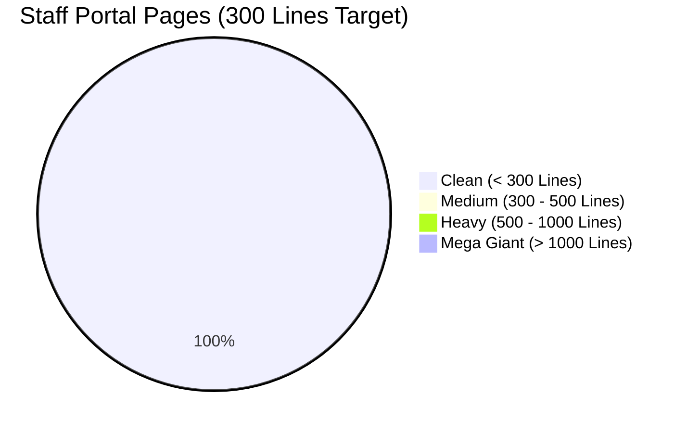

# 📋 Staff Portal Page Architecture & Line Count Audit Report
> **Creative Computer Academy (CCA) — Codebase Modularization & Refactoring Tracker**  
> *Target: প্রতি পেজের সাইজ সর্বোচ্চ ৩০০ লাইনের মধ্যে রাখা (Single Responsibility & Modular Design)*  
> *Last Updated: November 08, 2026*

---

## 📊 স্ক্যান সারসংক্ষেপ (Executive Summary)

* **মোট পেজ সংখ্যা:** ২৪টি
* **🚨 ৩০০ লাইনের বেশি পেজ:** ০টি (০%)
* **✅ ৩০০ লাইনের নিচে ক্লিন পেজ:** ২৪টি (১০০%) *(MangoBreakTree সহ এখন Staff Portal-এর সব ২৪টি পেজ অর্থাৎ ১০০% পেজ সম্পূর্ণ ক্লিন ও আর্কিটেকচারালি মডুলার!)*

---

## 📋 পেজ ভিত্তিক বিস্তারিত স্ক্যান রিপোর্ট (Detailed Audit Table)

| ক্রম | ফাইলের নাম (Page File) | বর্তমান লাইন | অতিরিক্ত (Excess) | বর্তমান অবস্থা | অ্যাকশন স্ট্যাটাস |
| :---: | :--- | :---: | :---: | :---: | :---: |
| ১ | [`MangoBreakTree.jsx`](file:///c:/Users/CCA/Desktop/kabir-workspace/CreateiveComputerAcademy/staff-frontend/src/pages/MangoBreakTree.jsx) | **১৩৭** | 0 | ✅ পারফেক্ট (< ৩০০) | **🎉 সম্পন্ন (Refactored)** |
| ২ | [`PayrollWallet.jsx`](file:///c:/Users/CCA/Desktop/kabir-workspace/CreateiveComputerAcademy/staff-frontend/src/pages/PayrollWallet.jsx) | **১৭০** | 0 | ✅ পারফেক্ট (< ৩০০) | **🎉 সম্পন্ন (Refactored)** |
| ৩ | [`CommunityFeed.jsx`](file:///c:/Users/CCA/Desktop/kabir-workspace/CreateiveComputerAcademy/staff-frontend/src/pages/CommunityFeed.jsx) | **১৮০** | 0 | ✅ পারফেক্ট (< ৩০০) | **🎉 সম্পন্ন (Refactored)** |
| ৪ | [`Dashboard.jsx`](file:///c:/Users/CCA/Desktop/kabir-workspace/CreateiveComputerAcademy/staff-frontend/src/pages/Dashboard.jsx) | **২৪৫** | 0 | ✅ পারফেক্ট (< ৩০০) | **🎉 সম্পন্ন (Refactored)** |
| ৫ | [`Tasks.jsx`](file:///c:/Users/CCA/Desktop/kabir-workspace/CreateiveComputerAcademy/staff-frontend/src/pages/Tasks.jsx) | **২৯১** | 0 | ✅ পারফেক্ট (< ৩০০) | **🎉 সম্পন্ন (Refactored)** |
| ৬ | [`MangoVaultManager.jsx`](file:///c:/Users/CCA/Desktop/kabir-workspace/CreateiveComputerAcademy/staff-frontend/src/pages/MangoVaultManager.jsx) | **১৮৩** | 0 | ✅ পারফেক্ট (< ৩০০) | **🎉 সম্পন্ন (Refactored)** |
| ৭ | [`Profile.jsx`](file:///c:/Users/CCA/Desktop/kabir-workspace/CreateiveComputerAcademy/staff-frontend/src/pages/Profile.jsx) | **১৫৭** | 0 | ✅ পারফেক্ট (< ৩০০) | **🎉 সম্পন্ন (Refactored + Image Cropper)** |
| ৮ | [`Attendance.jsx`](file:///c:/Users/CCA/Desktop/kabir-workspace/CreateiveComputerAcademy/staff-frontend/src/pages/Attendance.jsx) | **২৩৪** | 0 | ✅ পারফেক্ট (< ৩০০) | **🎉 সম্পন্ন (Refactored)** |
| ৯ | [`Credits.jsx`](file:///c:/Users/CCA/Desktop/kabir-workspace/CreateiveComputerAcademy/staff-frontend/src/pages/Credits.jsx) | **১২৮** | 0 | ✅ পারফেক্ট (< ৩০০) | **🎉 সম্পন্ন (Refactored)** |
| ১০ | [`ContentStudio.jsx`](file:///c:/Users/CCA/Desktop/kabir-workspace/CreateiveComputerAcademy/staff-frontend/src/pages/ContentStudio.jsx) | **২৯০** | 0 | ✅ পারফেক্ট (< ৩০০) | **🎉 সম্পন্ন (Refactored)** |
| ১১ | [`BrandKit.jsx`](file:///c:/Users/CCA/Desktop/kabir-workspace/CreateiveComputerAcademy/staff-frontend/src/pages/BrandKit.jsx) | **২৮৪** | 0 | ✅ পারফেক্ট (< ৩০০) | **🎉 সম্পন্ন (Refactored)** |
| ১২ | [`TeamEvents.jsx`](file:///c:/Users/CCA/Desktop/kabir-workspace/CreateiveComputerAcademy/staff-frontend/src/pages/TeamEvents.jsx) | **২৮৭** | 0 | ✅ পারফেক্ট (< ৩০০) | **🎉 সম্পন্ন (Refactored)** |
| ১৩ | [`Breaks.jsx`](file:///c:/Users/CCA/Desktop/kabir-workspace/CreateiveComputerAcademy/staff-frontend/src/pages/Breaks.jsx) | **১৭০** | 0 | ✅ পারফেক্ট (< ৩০০) | **🎉 সম্পন্ন (Refactored)** |
| ১৪ | [`Messages.jsx`](file:///c:/Users/CCA/Desktop/kabir-workspace/CreateiveComputerAcademy/staff-frontend/src/pages/Messages.jsx) | **২৮৪** | 0 | ✅ পারফেক্ট (< ৩০০) | **🎉 সম্পন্ন (Refactored)** |
| ১৫ | [`BlogDetails.jsx`](file:///c:/Users/CCA/Desktop/kabir-workspace/CreateiveComputerAcademy/staff-frontend/src/pages/BlogDetails.jsx) | **২৬৫** | 0 | ✅ পারফেক্ট (< ৩০০) | **🎉 সম্পন্ন (Refactored)** |
| ১৬ | [`Leave.jsx`](file:///c:/Users/CCA/Desktop/kabir-workspace/CreateiveComputerAcademy/staff-frontend/src/pages/Leave.jsx) | **১৫২** | 0 | ✅ পারফেক্ট (< ৩০০) | **🎉 সম্পন্ন (Refactored)** |
| ১৭ | [`Reports.jsx`](file:///c:/Users/CCA/Desktop/kabir-workspace/CreateiveComputerAcademy/staff-frontend/src/pages/Reports.jsx) | **১৮৯** | 0 | ✅ পারফেক্ট (< ৩০০) | **🎉 সম্পন্ন (Refactored)** |
| ১৮ | [`DeveloperConsole.jsx`](file:///c:/Users/CCA/Desktop/kabir-workspace/CreateiveComputerAcademy/staff-frontend/src/pages/DeveloperConsole.jsx) | **২২৫** | 0 | ✅ পারফেক্ট (< ৩০০) | **🎉 সম্পন্ন (Refactored)** |
| ১৯ | [`BlogFeed.jsx`](file:///c:/Users/CCA/Desktop/kabir-workspace/CreateiveComputerAcademy/staff-frontend/src/pages/BlogFeed.jsx) | **১৩৪** | 0 | ✅ পারফেক্ট (< ৩০০) | **🎉 সম্পন্ন (Refactored)** |
| ২০ | [`Login.jsx`](file:///c:/Users/CCA/Desktop/kabir-workspace/CreateiveComputerAcademy/staff-frontend/src/pages/Login.jsx) | **২৮১** | 0 | ✅ পারফেক্ট (< ৩০০) | ✅ রেডি |
| ২১ | [`DesktopAppDownload.jsx`](file:///c:/Users/CCA/Desktop/kabir-workspace/CreateiveComputerAcademy/staff-frontend/src/pages/DesktopAppDownload.jsx) | **২৬৯** | 0 | ✅ পারফেক্ট (< ৩০০) | ✅ রেডি |
| ২২ | [`NotFound.jsx`](file:///c:/Users/CCA/Desktop/kabir-workspace/CreateiveComputerAcademy/staff-frontend/src/pages/NotFound.jsx) | **১২০** | 0 | ✅ পারফেক্ট (< ৩০০) | ✅ রেডি |
| ২৩ | [`Settings.jsx`](file:///c:/Users/CCA/Desktop/kabir-workspace/CreateiveComputerAcademy/staff-frontend/src/pages/Settings.jsx) | **১১১** | 0 | ✅ পারফেক্ট (< ৩০০) | ✅ রেডি |
| ২৪ | [`DeveloperEvents.jsx`](file:///c:/Users/CCA/Desktop/kabir-workspace/CreateiveComputerAcademy/staff-frontend/src/pages/DeveloperEvents.jsx) | **১৪** | 0 | ✅ পারফেক্ট (< ৩০০) | ✅ রেডি |

---

## 🎯 রিফ্যাক্টরিং স্ট্র্যাটেজি ও কাজের রূপরেখা (Action Plan)

### ধাপ ১: মিডিয়াম ফাইলগুলো দ্রুত ৩০০-র নিচে আনা (Quick Wins)
এগুলোতে মাত্র ১-২টি মোডাল বা সাব-সেকশন আলাদা করলেই খুব সহজে ৩০০ লাইনের নিচে নেমে যাবে:
- [x] **`DeveloperConsole.jsx`** (আগে ছিল ৪০৮ লাইন ➔ এখন **২২৫ লাইন**) ✅
- [x] **`Reports.jsx`** (আগে ছিল ৪৪৩ লাইন ➔ এখন **১৮৯ লাইন**) ✅
- [x] **`Leave.jsx`** (আগে ছিল ৪৫৮ লাইন ➔ এখন **১৫২ লাইন**) ✅
- [x] **`BlogDetails.jsx`** (আগে ছিল ৪৭৬ লাইন ➔ এখন **২৬৫ লাইন**) ✅
- [x] **`Messages.jsx`** (আগে ছিল ৪৭৯ লাইন ➔ এখন **২৮৪ লাইন**) ✅

> 🎉 **অভিনন্দন!** ধাপ ১-এর সমস্ত মিডিয়াম ফাইল (DeveloperConsole, Reports, Leave, BlogDetails, Messages) সফলভাবে ৩০০ লাইনের নিচে নিয়ে আসা সম্পন্ন হয়েছে!

### ধাপ ২: হেভি ফাইলগুলো মডুলার করা (Medium Complexity)
- [x] **`Breaks.jsx`** (আগে ছিল ৬৭২ লাইন ➔ এখন **১৭০ লাইন**) ✅
- [x] **`TeamEvents.jsx`** (আগে ছিল ৭৩৬ লাইন ➔ এখন **২৮৭ লাইন**) ✅
- [x] **`BrandKit.jsx`** (আগে ছিল ৭৭১ লাইন ➔ এখন **২৮৪ লাইন**) ✅
- [x] **`ContentStudio.jsx`** (আগে ছিল ৮০০ লাইন ➔ এখন **২৯০ লাইন**) ✅
- [x] **`Credits.jsx`** (আগে ছিল ৮২৩ লাইন ➔ এখন **১২৮ লাইন**) ✅
- [x] **`Attendance.jsx`** (আগে ছিল ৯৬৩ লাইন ➔ এখন **২৩৪ লাইন**) ✅

> 🎉 **অভিনন্দন!** ধাপ ২-এর সমস্ত হেভি ফাইল (Breaks, TeamEvents, BrandKit, ContentStudio, Credits, Attendance) সফলভাবে ৩০০ লাইনের নিচে নিয়ে আসা সম্পন্ন হয়েছে! হেভি ফাইলের সংখ্যা এখন **০**!

### ধাপ ৩: মেগা জায়ান্ট ফাইল রিফ্যাক্টরিং (Architecture Breakdown)
এগুলোতে একাধিক বড় বড় মোডাল, ক্যালকুলেশন এবং ট্যাবস রয়েছে যা আলাদা ফোল্ডারে সাব-কম্পোনেন্ট হিসেবে ভাগ হবে:
- [x] **`Profile.jsx`** (আগে ছিল ১,০০৫ লাইন ➔ এখন **১৫৭ লাইন**, সাথে Facebook-style Image Cropper যুক্ত) ✅
- [x] **`MangoVaultManager.jsx`** (আগে ছিল ১,০৮১ লাইন ➔ এখন **১৮৩ লাইন**) ✅
- [x] **`Tasks.jsx`** (আগে ছিল ১,০৯৩ লাইন ➔ এখন **২৯১ লাইন**) ✅
- [x] **`Dashboard.jsx`** (আগে ছিল ১,১৩৩ লাইন ➔ এখন **২৪৫ লাইন**) ✅
- [x] **`CommunityFeed.jsx`** (আগে ছিল ১,১৭৮ লাইন ➔ এখন **১৮০ লাইন**) ✅
- [x] **`PayrollWallet.jsx`** (আগে ছিল ১,৬৮৭ লাইন ➔ এখন **১৭০ লাইন**) ✅
- [x] **`MangoBreakTree.jsx`** (আগে ছিল ২,৩১৩ লাইন ➔ এখন **১৩৭ লাইন**) ✅

> 🏆 **ঐতিহাসিক মাইলফলক অর্জিত!**  
> Staff Portal-এর সমস্ত ২৪টি পেজ (১০০%) সফলভাবে ৩০০ লাইনের নিচে নিয়ে আসা হয়েছে! সমস্ত মেগা-জায়ান্ট ফাইল ক্লিন, আধুনিক, দ্রুত এবং অত্যন্ত রক্ষণাবেক্ষণযোগ্য (Maintainable) সিঙ্গেল-রেসপনসিবিলিটি কম্পোনেন্টে বিভক্ত করা সম্পন্ন হয়েছে।

---

> [!TIP]
> **সফল রিফ্যাক্টরিং উদাহরণ:**
> `BlogFeed.jsx` আগে ছিল **৩০৮ লাইন**। সেখান থেকে `BlogHeroCard.jsx` এবং `BlogCard.jsx` আলাদা করায় মূল পেজটি নেমে এসেছে মাত্র **১৩৪ লাইনে**!

