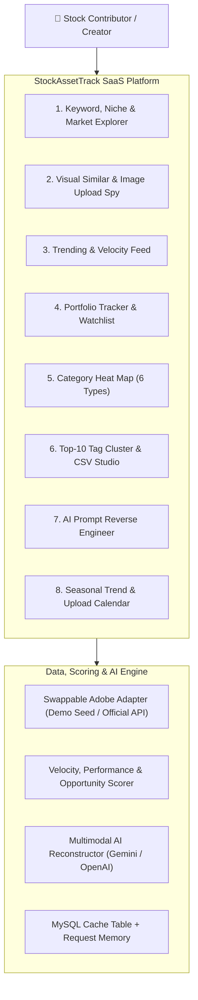
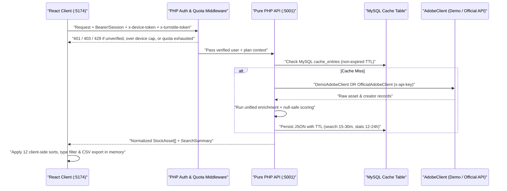

# 🚀 StockAssetTrack — Master Project Blueprint & System Architecture

## 1. Executive Summary & Vision

**StockAssetTrack** (`stockassettrack.com`) is a modern, high-performance **Microstock Analytics & Niche Intelligence SaaS Platform** designed specifically for **Adobe Stock contributors, vector artists, photographers, and Generative AI creators** (Midjourney, Flux, Stable Diffusion, DALL-E).

Inspired by platforms like **TasTracker** (`tastracker.com`) and **TrackAdobe**, StockAssetTrack eliminates guesswork for contributors by transforming raw marketplace data into actionable insights: identifying high-demand & low-competition niches, tracking competitor portfolio performance, reverse-engineering best-selling assets, extracting high-converting metadata clusters, and reconstructing AI prompts.

---

## 2. Competitive Benchmark Audit (`tastracker.com` Reference)

Before finalizing the `StockAssetTrack` architecture, an authenticated (`PRO` tier) technical audit of `https://tastracker.com` was performed across UI flows, `sitemap.xml`, `robots.txt`, client bundles, and network traffic.

### 2.1 Observed Route & Feature Matrix
| Route | Access Tier | Observed Functionality |
|---|---|---|
| `/` | Public | Marketing landing page, feature preview, pricing overview, FAQ `<details>` accordion |
| `/search` | Free (`2/day`), Starter (`20/day`), Pro (`Unlimited`) | Keyword/Asset ID search, `Search by Image` modal, `Saved` drawer, Market Summary Bar, 100-card grid, 12 client-side sorts, CSV export |
| `/trending` | PRO | Reuses search module and auto-fires `GET /api/search?q=` to surface fresh, high-velocity assets |
| `/contributor` | Starter / PRO | Portfolio Tracker via Adobe Stock URL or numeric Creator ID, KPI header (`Total Assets`, `AI %`, `Non-AI`, `Downloads`), Recent Searches, 100-card grid |
| `/category-heatmap` | Starter / PRO | Category Heat Map across 6 media types (`Photo` 44, `Illustration` 24, `Vector` 17, `Video` 24, `Template` 2, `3d` 9) sampled from top 100 downloads/type, 3 metric modes, 5-tier legend |
| `/similar?imageId=<id>` | PRO | Visual Similar Images grid (also handles `/similar?source=upload&page=1` from uploaded images) |
| `/tools` | Public (`FREE` pill) | Showcase directory for **4 Chrome extensions** (`MetaForge`, `ZeroBg`, `Upload Sync`, `ShutterPen`) + AI/NSFW policy *(no in-browser web calculators)* |
| `/blog` & `/blog/<slug>` | Public | 10 Adobe Stock SEO/AI/workflow articles with keyword search and 6 category filter chips |
| `/pricing` | Public | 4 tiers (`Free` \$0, `Starter` \$4/mo, `Pro` \$8/mo, `Annual` \$67 yr 1 then \$96/yr) + Card (`Creem`/`Stripe`), Crypto (`Cryptomus`), `PKR`, `BDT` |
| `/dashboard`, `/dashboard/billing`, `/dashboard/settings` | Auth | Active plan status, daily search counter (`searchesToday` / `searchesLimit`), billing history, display name/password, active device slots (`3 / 3`) |
| `/auth/device-limit` | Auth Guard | Over-limit session gate allowing user to replace an active device slot (`POST /api/user/device/replace`) |
| `/extensions/*/privacy` | Public | Extension privacy policies (`metaforge`, `upload-sync`, `shutterpen`) |
| `/admin/`, `/checkout/`, `/custom-offers/`, `/auth/` | Disallowed (`robots.txt`) | Protected internal/checkout route prefixes |

### 2.2 How TasTracker Works Under the Hood
- **Stack & Rendering:** Next.js **App Router** (`__next_f` RSC streaming payloads), Tailwind CSS, Radix UI primitives, Lucide icons, Sonner toast notifications (Heat Map uses CSS Grid tiles rather than a charting library).
- **100% Server-Side Upstream Proxy:** Zero direct browser API calls go to `stock.adobe.com` or `adobe.io`. All search, stats, country, and category calls go through `/api/*`, while the browser loads media directly from Adobe CDNs (`t3.ftcdn.net` / `t4.ftcdn.net` `500_F_` cards and `1000_F_` lightbox previews; `v.ftcdn.net/.../700_F_<id>_<hash>_ST.mp4` video previews with `206 Partial Content`).
- **3-Layer Anti-Scraping & Auth Security:**
  1. NextAuth JWE session cookies (`__Secure-next-auth.session-token`, `__Host-next-auth.csrf-token`) + device-slot tracking (`x-device-token`, max `1/1/3/5` devices by tier).
  2. Short-lived signed CSR token (`POST /api/auth/csr-token` → 15 min TTL `{ token, expiresIn: 900000 }`, sent in `x-csr-token`).
  3. Cloudflare Turnstile (`x-turnstile-token`) + `x-requested-with: XMLHttpRequest`.
- **`encodedEnrichment` Payload Obfuscation:** Next.js RSC injects a user-scoped UUID `enrichmentKey`. `/api/search` and `/api/contributor-search` return scrubbed item placeholders (`downloads: 0, keywords: "", creatorId: ""`) plus an `encodedEnrichment` string decoded on the client via **Base64 decode + repeating-key UTF-8 XOR** into `{ [assetId]: { d: downloads, k: keywordsString, c: creatorId } }`.
- **Caching & Proxy Helpers:**
  - `POST /api/images/stats` results cached in `localStorage`.
  - `POST /api/upload-search` results cached in `sessionStorage` before redirecting to `/similar?source=upload&page=1`.
  - `GET /api/contributor-stats` served from server memory cache (`source: "memory"`).
  - `POST /api/contributor-country` batch-resolves `{ creatorIds }` to country codes and flags (`"📍"` fallback).
  - `GET /api/images/proxy?url=...` acts as a CORS fallback so HTML5 `<canvas>` can copy `ftcdn.net` images to the clipboard as PNG.

### 2.3 Exact Observed Query Parameter Mappings
| Control | UI Labels → Exact Query Param Values |
|---|---|
| `order` (Sort By) | `Relevance` → `"relevance"` *(omitted when default)*, `Newest` → `"creation"`, `Featured` → `"featured"`, `Most Downloaded` → `"nb_downloads"`, `Undiscovered` → `"undiscovered"` |
| `content_type` | `All Types` → `"all"`, `Photo` → `"photo"`, `Illustration` → `"illustration"`, `Vector` → `"vector"`, `Video` → `"video"`, `Template` → `"template"`, `3D` → `"3d"` |
| `generative_ai` | `All` → `"all"` *(omitted when default)*, `AI Only` → `"only"`, `Exclude AI` → `"exclude"` |
| `page` | `page=<N>` appended only when `page > 1` |

### 2.4 Live TasTracker Bugs & Gaps (Safeguards Built Into `StockAssetTrack`)
1. **Vector `creationDate` Undefined Crash:** `content_type=vector` on TasTracker crashed React (`TypeError: Cannot read properties of undefined (reading 'length')`) because vector items lacked `creationDate`.  
   → **Fix:** Type `creationDate: string | null`, enforce null-safe parsing, and render `monthlyVelocity: null` (`"N/A"`) cleanly.
2. **Un-Enriched `/similar` Grid (`0` / `NaN`):** `/api/similar` returned `downloads: 0`, `keywords: ""`, and no `creationDate`, logging `NaN` in card metrics.  
   → **Fix:** Route `/api/similar` and `/api/upload-search` through the exact same enrichment and scoring pipeline as `/api/search`.
3. **Inconsistent Quota Enforcement:** `/api/usage/check` returned `403 {"error":"Email not verified"}` while `/api/search` still returned `200`.  
   → **Fix:** Enforce email verification and daily quotas **atomically in server middleware** on every search/AI endpoint.
4. **Turnstile Config Error:** Passing `size: "invisible"` threw `Uncaught TurnstileError`.  
   → **Fix:** Use valid Turnstile parameters (`size: "normal" | "compact" | "flexible"` with `appearance: "execute"` or `"interaction-only"`).
5. **Video Lightbox `ArrowRight` Focus Clash:** Pressing `ArrowRight` while `<video>` holds focus scrubs video time instead of advancing slides.  
   → **Fix:** Explicitly handle lightbox slide shortcuts without conflicting with focused video playback controls.

*(Note: Exact CSV column header order, exact `Medium` competition cutoff, and the exact minified `PERFORMANCE` piecewise expression inside TasTracker were not extracted from minified JS; `StockAssetTrack` defines explicit, transparent specs for each in Section 5.)*

---

## 3. Core Feature Modules (TasTracker Parity + `StockAssetTrack` Differentiators)



### Module 1: Keyword, Niche & Market Explorer (`/search`)
- **Inputs:** Keyword or Asset ID search, clipboard `Paste`, `Sort By` (`relevance`, `creation`, `featured`, `nb_downloads`, `undiscovered`), `Content Type` (`all`, `photo`, `illustration`, `vector`, `video`, `template`, `3d`), `Generative AI` (`all`, `only`, `exclude`), quick popular search chips, and `Saved` drawer trigger.
- **Market Summary Header:** Total results count, **Competition Level** (`Low` / `Medium` / `High`), **Demand Score (1–100)**, **Competition Score (1–100)**, **Opportunity Index (1–100)**, **Trend Classification** (`Evergreen`, `Seasonal Spike`, `Breakout Trending`), content-type distribution counts, and **AI vs Real** split (`% AI`).
- **Instant Client-Side Results Toolbar (100 results/page):**
  - 12 post-fetch sort modes (`Default`, `Most/Least Downloads`, `Newest/Oldest First`, `Best Performance`, `AI/Non-AI First`, `Most/Least Keywords`, `Shortest/Longest Title`).
  - Secondary media-type filter, `Select All`, and dual **Export CSV** (Analytics CSV or Adobe Stock Contributor CSV).
- **Rich Asset Cards & Lightbox:**
  - `500_F_` thumbnail (or video preview indicator), `Ai` badge, `View full size` (`1000_F_` lightbox or HTML5 `v.ftcdn.net` video player), `Copy image` (Canvas + `/api/images/proxy`), `Open on Adobe Stock`, `Save to favorites`, `Find Similar`, `Reconstruct AI Prompt`.
  - Metrics: `DOWNLOADS`, `PERFORMANCE /100`, `~X D/M`, Category link, Media type, null-safe Upload date + relative age, Contributor + country flag, expandable keyword pills + `Copy all keywords`.

### Module 2: Visual Similar & Image Upload Discovery (`/similar`)
- **By Asset ID:** `/similar?imageId=<id>` finds visually similar Adobe Stock assets with **full download, velocity, performance, and keyword enrichment**.
- **By Image Upload:** Drag-and-drop PNG/JPG/GIF (up to 10MB) via `POST /api/upload-search` → caches preview & results in `sessionStorage` and navigates to `/similar?source=upload&page=1`.

### Module 3: Trending & Best-Selling Velocity Spy (`/trending`)
- Automatically surfaces high-velocity recent uploads across categories and media types with filters for AI-only/non-AI and full CSV export.

### Module 4: Contributor Portfolio Tracker & Watchlist (`/tracker`)
- **Lookup:** Paste any Adobe Stock contributor URL or numeric Creator ID; keep `Recent Searches` chips and `View on Adobe Stock` outbound link.
- **KPIs & Charts:** Contributor name, ID, resolved country flag, `Total Assets`, `AI` count & `%`, `Non-AI` count, `Total Downloads`, plus **Recharts** area/sparkline charts for upload & download velocity.
- **Competitor Watchlist:** Save competitor accounts to the `Saved` drawer / database watchlist to monitor new uploads and top-moving files.

### Module 5: Category Heat Map (`/heatmap`)
- Samples top-performing assets across **6 media types** (`Photo`, `Illustration`, `Vector`, `Video`, `Template`, `3D`).
- Metric selector: `Downloads (in top 100)`, `Avg Downloads per Asset`, `Sample Size`, rendered on a 5-tier intensity color scale where clicking any category tile opens `/search?q=<category>`.

### Module 6: Metadata & Top-10 Tag Cluster Extractor (`/tags`)
- Aggregates and deduplicates tags from the **top 10–20 selling assets** for any keyword or selected cards.
- Ranks tags by frequency, buyer intent, and relevance; exports directly to **Adobe Stock Contributor Submission CSV** (`Filename,Title,Keywords,Category,Releases`) or 1-click copy.

### Module 7: AI Prompt Reverse Engineer (`/prompts`)
- Evaluates top-selling AI assets (lighting, medium, lens/composition, color palette, subject staging) via Gemini / OpenAI multimodal APIs.
- Outputs ready-to-use prompt variants tailored for **Midjourney v6**, **Flux 1.1 Pro**, and **Stable Diffusion**.

### Module 8: Seasonal Trend & Upload Calendar (`/calendar`)
- 60–90 day predictive production roadmap (e.g., preparing Ramadan/Eid or Q4 holiday assets months ahead), with each calendar event linking directly into Niche Explorer (`/search?q=...`).

---

## 4. Technology Stack & Decoupled Architecture

Keeping `client/` (static React Vite build) and `server/` (**Clean Pure PHP 8.2 + PDO + MySQL/MariaDB**) decoupled avoids Hostinger `Web Apps` 5-slot/NPROC limits while matching `PHP/HTML` hosting reliability 24/7 with zero Composer/Redis dependencies.

```text
StockAssetTrack/
├── client/                              # React 18 + Vite + TypeScript + Tailwind CSS (Port 5174)
│   ├── src/
│   │   ├── pages/
│   │   │   ├── LandingPage.tsx          # Public hero, feature showcase, pricing preview, FAQ
│   │   │   ├── SearchPage.tsx           # Keyword/ID search, Market Summary, 12 sorts, CSV export
│   │   │   ├── TrendingPage.tsx         # High-velocity recent assets feed
│   │   │   ├── SimilarPage.tsx          # Fully enriched similar & upload-search results
│   │   │   ├── TrackerPage.tsx          # Portfolio lookup, KPIs, Recharts velocity, Watchlist
│   │   │   ├── HeatmapPage.tsx          # 6-type Category Heat Map with 5-tier color legend
│   │   │   ├── TagClusterPage.tsx       # Top-10 aggregated tag frequency & Adobe CSV studio
│   │   │   ├── PromptEngineerPage.tsx   # Midjourney / Flux / SD prompt reverse-engineering
│   │   │   ├── CalendarPage.tsx         # 60-90 day Seasonal Event & Production Roadmap
│   │   │   ├── PricingPage.tsx          # Tier comparison & multi-gateway checkout
│   │   │   ├── LegalPage.tsx            # Contact, Privacy Policy, Terms (Affiliate review ready)
│   │   │   └── DashboardPage.tsx        # Usage quota, billing history, profile & device slots
│   │   ├── components/
│   │   │   ├── Navbar.tsx               # Navigation, Saved drawer trigger, theme toggle, tier badge
│   │   │   ├── SearchControls.tsx       # Input, Paste, Upload Similar modal, Sort/Type/AI filters
│   │   │   ├── MarketSummaryBar.tsx     # Results count, Opportunity Index, AI vs Real split
│   │   │   ├── ResultsToolbar.tsx       # 12 client-side sorts, type filter, Select All, Export CSV
│   │   │   ├── AssetCard.tsx            # Null-safe card, video badge, tags, action controls
│   │   │   ├── LightboxModal.tsx        # 1000_F_ preview, HTML5 video player, safe arrow nav
│   │   │   └── SavedDrawer.tsx          # Saved Contributors & Saved Assets tabs
│   │   ├── hooks/                       # Client sort/filter engine, localStorage stats cache
│   │   ├── services/api.ts              # Typed API client (CSR/device headers, retry handling)
│   │   └── types/stock.ts               # Shared TypeScript interfaces
│   ├── package.json
│   └── tailwind.config.ts
│
├── server/                              # Clean Pure PHP 8.2 + PDO + MySQL/MariaDB (Port 5001)
│   ├── public/
│   │   ├── index.php                    # Front controller, CORS, error handler, route dispatch
│   │   └── .htaccess                    # Apache / Hostinger PHP/HTML rewrite rules
│   ├── config/
│   │   ├── env.php                      # Safe .env file loader (no external dependencies)
│   │   ├── app.php                      # App URLs, CORS origins, scoring thresholds, plan limits
│   │   └── database.php                 # PDO MySQL/MariaDB connection config
│   ├── src/
│   │   ├── Core/
│   │   │   ├── Request.php              # Parsed query, JSON body, headers, file uploads
│   │   │   ├── Response.php             # Standardized JSON / binary / error responses
│   │   │   ├── Router.php               # Clean REST method + path dispatcher
│   │   │   ├── Database.php             # Singleton PDO wrapper (prepared statements)
│   │   │   ├── Cache.php                # MySQL cache_entries table + request memory cache
│   │   │   └── Validator.php            # Strict input validation helpers
│   │   ├── Middleware/
│   │   │   ├── AuthMiddleware.php       # Signed token / session + device-slot check
│   │   │   ├── QuotaMiddleware.php      # Atomic daily quota & email-verified enforcement
│   │   │   └── SecurityMiddleware.php   # MySQL rate limiting, Turnstile verification, CSR token
│   │   ├── Controllers/
│   │   │   ├── HealthController.php     # GET /api/health (PHP, DB & Adobe mode check)
│   │   │   ├── SearchController.php     # GET /api/search, /api/similar, POST /api/upload-search
│   │   │   ├── TrendingController.php   # GET /api/trending
│   │   │   ├── ContributorController.php# GET /api/contributor/*, POST /country, watchlist
│   │   │   ├── AnalyticsController.php  # GET /api/heatmap, POST /api/keywords/clusters, /calendar
│   │   │   ├── AiController.php         # POST /api/prompts/reconstruct
│   │   │   ├── ProxyController.php      # GET /api/images/proxy, POST /api/images/stats
│   │   │   └── UserController.php       # Auth, devices, favorites, billing webhooks, cron hooks
│   │   └── Services/
│   │       ├── AdobeClientInterface.php # Swappable contract for demo vs official API
│   │       ├── DemoAdobeClient.php      # Phase 1-5 realistic seed/demo dataset adapter
│   │       ├── OfficialAdobeClient.php  # Option A Adobe Stock API (x-api-key) drop-in adapter
│   │       ├── AdobeClientFactory.php   # Selects adapter via ADOBE_DATA_MODE=demo|official
│   │       ├── EnrichmentService.php    # Unified enrichment for search, similar, upload & tracker
│   │       ├── ScoringService.php       # D/M velocity, Performance, Demand/Competition/Opportunity
│   │       ├── TagClusterService.php    # Multi-asset keyword aggregation & intent ranking
│   │       ├── PromptAiService.php      # Gemini / OpenAI cURL multimodal prompt reconstruction
│   │       └── HeatmapService.php       # 6-type top-100 snapshot builder (cron-triggered)
│   ├── database/
│   │   └── schema.sql                   # MariaDB 10.4+ / MySQL 8 UTF8MB4 schema (191-char indexed)
│   ├── .env.example
│   └── .env
│
└── docs/
    └── PROJECT_BLUEPRINT.md
```

---

## 5. Exact Data Contracts, Scoring Formulas & Security Flow

### 5.1 Request Security & Enrichment Lifecycle


### 5.2 Core TypeScript Interfaces (`client/src/types/stock.ts`)
```ts
export type MediaType = "Photo" | "Illustration" | "Vector" | "Video" | "Template" | "3D";
export type SortOption = "relevance" | "creation" | "featured" | "nb_downloads" | "undiscovered";
export type GenAIFilter = "all" | "only" | "exclude";

export interface StockAsset {
  id: string;
  title: string;
  thumbnailUrl: string;          // 500_F_ thumbnail
  preview1000Url: string;        // 1000_F_ lightbox image
  videoPreviewUrl: string | null;// v.ftcdn.net MP4 for videos
  mediaType: MediaType;
  mediaTypeId: 1 | 2 | 3 | 4 | 7 | 8;
  contentType: string;
  category: string;
  dimensions: string;
  creationDate: string | null;   // Null-safe (fixes TasTracker vector crash)
  isAI: boolean;
  downloads: number;
  monthlyVelocity: number | null;// null when creationDate is missing
  performanceScore: number;      // 0..100
  keywords: string[];
  creator: string;
  creatorId: string;
  creatorCountry: { code: string; name: string; flag: string } | null;
}

export interface SearchSummary {
  query: string;
  totalResults: number;
  demandScore: number;           // 1..100
  competitionScore: number;      // 1..100
  opportunityIndex: number;      // 1..100
  competitionLevel: "Low" | "Medium" | "High";
  trendType: "Evergreen" | "Seasonal Spike" | "Breakout Trending";
  typeCounts: Record<"photo" | "illustration" | "vector" | "video", number>;
  aiSplit: { aiCount: number; realCount: number; aiPercent: number };
}
```

### 5.3 Explicit Formulas & CSV Column Specifications
1. **Monthly Velocity (`~X D/M`):**
   ```ts
   export function calcMonthlyVelocity(downloads: number, creationDate: string | null): number | null {
     if (!creationDate) return null;
     const parsed = Date.parse(creationDate);
     if (Number.isNaN(parsed)) return null;
     const months = Math.max(1, (Date.now() - parsed) / (1000 * 60 * 60 * 24 * 30.4375));
     return Math.round(downloads / months);
   }
   ```
2. **Performance Score (`0–100`, calibrated to empirical velocity curve):**
   - `velocity === null || velocity <= 0` → `0`
   - `0 < velocity <= 10` → `Math.min(40, Math.round(velocity * 4))` (`1 -> 4`, `4 -> 16`, `7 -> 28`, `10 -> 40`)
   - `10 < velocity <= 40` → `Math.round(40 + ((velocity - 10) / 30) * 35)` (`32 -> ~66`)
   - `velocity > 40` → `Math.min(100, Math.round(75 + ((velocity - 40) / 70) * 25))` (`110+ -> 100`)
3. **Competition Level & Opportunity Index:**
- **Competition Level** (configurable in `server/config/app.php`):
  - `totalResults < 10_000` → `"Low"`
  - `10_000 <= totalResults <= 500_000` → `"Medium"`
  - `totalResults > 500_000` → `"High"`
   - **Demand Score (`1–100`):** Normalized from mean/median `monthlyVelocity` and top-20 download volume of the result set.
   - **Competition Score (`1–100`):** Log-scaled saturation score from `totalResults`.
   - **Opportunity Index (`1–100`):** Weighted combination (`0.6 * DemandScore + 0.4 * (100 - CompetitionScore)`).
4. **Dual CSV Export Schemas:**
   - **Analytics CSV:** `Asset ID,Title,Media Type,Is AI,Downloads,Monthly Velocity (D/M),Performance Score,Dimensions,Category,Creator,Creator ID,Country,Creation Date,Keywords,Adobe Stock URL`
   - **Adobe Stock Contributor Submission CSV:** `Filename,Title,Keywords,Category,Releases`

### 5.4 MySQL / MariaDB Database & Cache Schema (`utf8mb4`, `191`-char indexed)
- **`users`**: `id`, `email`, `password_hash`, `display_name`, `email_verified_at`, `plan_tier` (`free | starter | pro | annual`), `created_at`
- **`subscriptions`**: `id`, `user_id`, `gateway` (`stripe | creem | cryptomus`), `external_sub_id`, `status`, `period_end`, `cancel_at_period_end`
- **`user_devices`**: `id`, `user_id`, `device_token_hash`, `device_label`, `last_active_at` (enforces `1 / 1 / 3 / 5` slots by plan)
- **`usage_logs`**: `(user_id, date_key)` atomic search & AI prompt counter
- **`favorites`**: `(user_id, item_type ['image' | 'contributor'], target_id, metadata_json, created_at)`
- **`contributor_watchlists`**: `(user_id, creator_id, last_total_assets, last_total_downloads, notify_enabled, updated_at)`
- **`cache_entries`**: `(cache_key, payload_json, expires_at)` — persistent MySQL TTL cache (Search `15–30 min`, Image stats `12–24 hrs`, Contributor stats `6 hrs`, Country lookups `30 days`, Category Heat Map snapshots `12–24 hrs`).
- **Image Proxy Allowlist:** `GET /api/images/proxy?url=` strictly validates hostnames against `*.ftcdn.net` (`https:` only) to prevent SSRF.

### 5.5 `StockAssetTrack` Backend API Contracts
| Domain | Endpoint | Method | Purpose / Contract |
|---|---|---|---|
| **Search & Discovery** | `/api/search` | `GET` | `q`, `order`, `content_type`, `generative_ai`, `page` → `{ summary: SearchSummary, assets: StockAsset[], page, hasMore }` |
| | `/api/trending` | `GET` | `order`, `content_type`, `generative_ai`, `page` → high-velocity recent `StockAsset[]` |
| | `/api/similar` | `GET` | `?imageId=<id>&page=` → **fully enriched** `StockAsset[]` |
| | `/api/upload-search` | `POST` | `FormData` (`image <= 10MB`, `page`) → visual similarity match + enriched `StockAsset[]` |
| **Contributor Tracker** | `/api/contributor/search` | `GET` | `search=<id_or_url>`, `order`, `content_type`, `generative_ai`, `page` → `{ assets: StockAsset[], hasMore, totalAssets }` |
| | `/api/contributor/stats` | `GET` | `?creatorId=<id>` → `{ status, totalDownloads, totalAssets, aiCount, aiPercent, computedAt, source }` |
| | `/api/contributor/country` | `POST` | `{ creatorIds: string[] }` → `{ countries: Record<string, { code, name, flag }> }` |
| | `/api/contributor/watchlist` | `GET`/`POST`/`DELETE` | Manage competitor watchlist & change alerts |
| **Analytics & AI Moat** | `/api/heatmap` | `GET` | `?metric=totalDownloads\|avgDownloads\|sampleSize` → 6-type Category Heat Map snapshot |
| | `/api/keywords/clusters` | `POST` | `{ query?, assetIds? }` → frequency & buyer-intent ranked keyword clusters |
| | `/api/prompts/reconstruct` | `POST` | `{ assetId \| imageUrl }` → Midjourney v6, Flux 1.1 Pro & Stable Diffusion prompts |
| | `/api/calendar` | `GET` | `?daysAhead=90` → upcoming seasonal events + niche query links |
| **Media & Stats Helpers** | `/api/images/stats` | `POST` | `{ imageIds: string[] }` → batch cached asset metrics |
| | `/api/images/proxy` | `GET` | `?url=<ftcdn_url>` → SSRF-safe `*.ftcdn.net` proxy for Canvas PNG clipboard copy |
| **User, Auth & Billing** | `/api/auth/*`, `/api/user/devices` | `GET`/`POST`/`DELETE` | Auth, email verification, CSR token, device slot validation (`1/1/3/5`) |
| | `/api/favorites` | `GET`/`POST`/`DELETE` | Saved images & saved contributors |
| | `/api/billing/*` | `GET`/`POST` | Checkout, portal, cancel/resubscribe & Stripe/Creem/Cryptomus webhooks |

---

## 6. Design & UI/UX Standards (Linear / Vercel Aesthetic)

- **Theme:** Ultra-clean deep dark mode (`bg-slate-950`) with subtle 40px grid mesh texture and radial fade mask, plus full light-mode toggle parity.
- **Accents:** Neon indigo (`#6366F1`), cyan (`#06B6D4`), and royal purple (`#8B5CF6`).
- **Data Visualization:** Recharts interactive sparklines, area charts for portfolio velocity, Opportunity Score progress rings, and 5-tier Category Heat Map grid tiles.
- **Responsiveness & Accessibility:** Fluid layouts across desktop, tablet, and mobile; Esc/Arrow Lightbox navigation isolated from video element focus; clear loading skeletons and error boundaries.

---

## 7. Development Milestones (6-Phase Execution Roadmap)

1. **Phase 1 — Foundation & UI Shell**
   - Initialize `client/` (React + Vite + TypeScript + Tailwind + Lucide + Recharts + Sonner + React Router) and `server/` (Clean Pure PHP 8.2 + PDO + MySQL/MariaDB, `.htaccess`, `.env`, `database/schema.sql`, `/api/health`).
   - Build shared `StockAsset` types, dark/light theme layout, navigation bar, `Saved` drawer, Legal/Contact pages (Affiliate review ready), and route placeholders.
2. **Phase 2 — Core Data Adapter, Search & Proxy (`/search`)**
   - Build `DemoAdobeClient.php` + swappable `OfficialAdobeClient.php` interface (`ADOBE_DATA_MODE=demo|official`), `Cache.php` (MySQL TTL), `ScoringService.php`, and SSRF-safe `GET /api/images/proxy`.
   - Implement `SearchPage` with Market Summary Bar, 12-mode instant client sorting, type filters, null-safe `AssetCard`, Lightbox (`1000_F_` + video preview), and dual CSV export.
3. **Phase 3 — Visual Discovery Modules (`/trending`, `/similar`, `/heatmap`)**
   - Implement `GET /api/trending`, fully enriched `GET /api/similar` & `POST /api/upload-search`, and the Hostinger Cron-triggered 6-type Category Heat Map job + UI.
4. **Phase 4 — Portfolio Tracker & Watchlist (`/tracker`)**
   - Implement URL/Creator ID parser, `GET /api/contributor/search` & `/stats`, batch `POST /api/contributor/country`, Recharts velocity charts, and Competitor Watchlist persistence in MySQL.
5. **Phase 5 — Competitive Moat Modules (`/tags`, `/prompts`, `/calendar`)**
   - Implement Top-10 Tag Cluster Extractor (`POST /api/keywords/clusters`), AI Prompt Reverse Engineer (`POST /api/prompts/reconstruct` via cURL), and 60–90 day Seasonal Upload Calendar.
6. **Phase 6 — Production SaaS Layer, Official API Switch & Deployment**
   - Implement Auth + email verification, atomic quota middleware, device-slot limits (`1/1/3/5`), properly configured Cloudflare Turnstile + MySQL rate limiting, payment webhooks, plug in `ADOBE_API_KEY` (`ADOBE_DATA_MODE=official`), and deploy `client/dist` + `server/` to Hostinger `PHP/HTML`.
