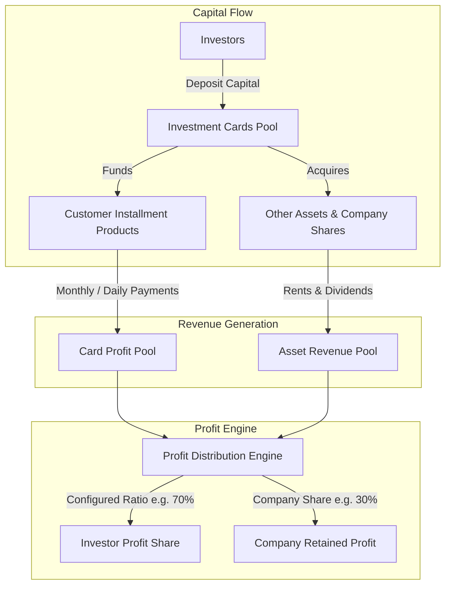
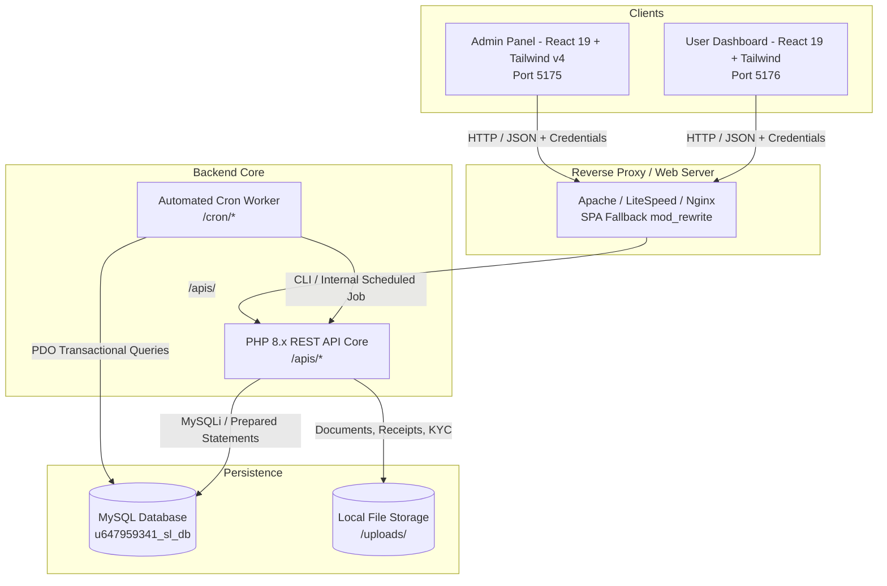
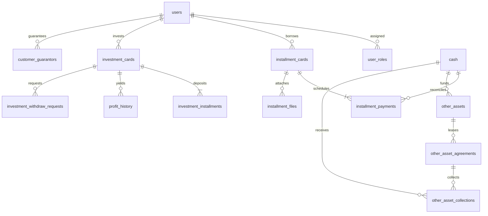

# 🏛️ SupplyLink — Master System Blueprint & Architectural Specification
> **System Name:** SupplyLink Micro-Financing, Installment & Multi-Source Profit Distribution Platform  
> **Repository:** `Others_Source_Profit`  
> **Version:** 2.0.0 (Enterprise Edition)  
> **Timezone Standard:** Asia/Dhaka (`GMT+6`)  
> **Target Currency:** BDT (৳)  

---

## 📑 Table of Contents
1. [Executive Summary & Business Domain](#1-executive-summary--business-domain)
2. [High-Level System Topology & Architecture](#2-high-level-system-topology--architecture)
3. [Component Breakdown](#3-component-breakdown)
   - [3.1 Admin Portal (`Admin_panel`)](#31-admin-portal-admin_panel)
   - [3.2 Client / Investor Portal (`User_Dashboard`)](#32-client--investor-portal-user_dashboard)
   - [3.3 Backend API Engine (`server/public_html/apis`)](#33-backend-api-engine-serverpublic_htmlapis)
   - [3.4 Automated Cron Engine (`server/public_html/cron`)](#34-automated-cron-engine-serverpublic_htmlcron)
4. [Database Architecture & Entity Relationships](#4-database-architecture--entity-relationships)
5. [Core Financial Models & Mathematical Algorithms](#5-core-financial-models--mathematical-algorithms)
   - [5.1 Cash Management & Opening Cash Balance Formula](#51-cash-management--opening-cash-balance-formula)
   - [5.2 Installment Loan Calculation & Card Lifecycle](#52-installment-loan-calculation--card-lifecycle)
   - [5.3 Investor Profit Generation (Time-Weighted Value)](#53-investor-profit-generation-time-weighted-value)
   - [5.4 Multi-Source Asset & Rental Revenue Distribution](#54-multi-source-asset--rental-revenue-distribution)
6. [Role-Based Access Control (RBAC) & Security](#6-role-based-access-control-rbac--security)
7. [API Catalog & Endpoint Registry](#7-api-catalog--endpoint-registry)
8. [Automated Cron Tasks & Background Schedulers](#8-automated-cron-tasks--background-schedulers)
9. [Deployment, Web Server & Environment Configuration](#9-deployment-web-server--environment-configuration)

---

## 1. Executive Summary & Business Domain

**SupplyLink** is an end-to-end FinTech enterprise management ecosystem designed for:
1. **Customer Installment Loans:** Hire-purchase financing for mobile devices, electronics, and tangible products with flexible daily, weekly, and monthly collection cards.
2. **Investor Capital Management:** Crowdsourced/syndicated investments where individual and institutional investors fund retail installment pools and commercial asset acquisitions.
3. **Multi-Source Profit Engine (`Others_Source_Profit`):** An advanced revenue expansion model combining:
   - Profit accrued from customer installment sales cards.
   - Profit from tangible physical assets (motorbikes, commercial spaces, shops, equipment).
   - Equity dividends from external company share investments.
4. **Transparent Profit Distribution:** Pro-rata monthly distribution calculated using **Time-Weighted Value (TWV)** and configurable investor-to-company split ratios (e.g., 70% Investor Pool / 30% Company Reserve).
5. **Double-Entry Cash Registry:** Real-time multi-branch cash in/out tracking with multi-stage approval hierarchies.



---

## 2. High-Level System Topology & Architecture

The application is engineered as a decoupled modular client-server architecture:



---

## 3. Component Breakdown

### 3.1 Admin Portal (`Admin_panel`)
- **Location:** [`/Admin_panel`](file:///c:/Users/CCA/Desktop/kabir-workspace/SupplyLink/Others_Source_Profit/Admin_panel)
- **Role:** Comprehensive back-office command center for directors, branch managers, collection staff, and system developers.
- **Key Modules:**
  - **Live Executive Dashboard:** Daily opening cash, collections, loans disbursed, pending approvals, and investor metrics.
  - **Cash Desk:** Cash In, Cash Out, approval pipeline, daily/monthly/yearly reports, thermal/voucher printing.
  - **User & Role Governance:** User onboarding, guarantor assignments, permissions (`admin`, `manager`, `staff`, `developer`).
  - **Customer & Installment Lifecycle:** Card creation, payment entries, collection schedules, guarantor verifications, customer dossiers.
  - **Investor Desk:** Investment cards, profit distributions, withdrawal request approvals, card closure settlements.
  - **Other Sources Profit:**
    - [`OtherSourcesAssets.jsx`](file:///c:/Users/CCA/Desktop/kabir-workspace/SupplyLink/Others_Source_Profit/Admin_panel/src/Pages/shared/OtherSourcesProfit/OtherSourcesAssets.jsx): Asset acquisitions (bikes, shops, houses, equipment, shares), depreciation, sale/liquidation.
    - [`OtherSourcesCollections.jsx`](file:///c:/Users/CCA/Desktop/kabir-workspace/SupplyLink/Others_Source_Profit/Admin_panel/src/Pages/shared/OtherSourcesProfit/OtherSourcesCollections.jsx): Lease agreements, monthly rental collections, dividend receipts, and distribution summary calculation.
  - **Stock Inventory & Suppliers:** Mobile devices & product catalog, IMEI tracking, supplier invoice payments.
  - **Company Health & Simulator:** Solvency ratios, debt-to-equity metrics, asset liquidity stress test, and portfolio closing simulation.

### 3.2 Client / Investor Portal (`User_Dashboard`)
- **Location:** [`/User_Dashboard`](file:///c:/Users/CCA/Desktop/kabir-workspace/SupplyLink/Others_Source_Profit/User_Dashboard)
- **Role:** Self-service portal for retail borrowers and financial investors.
- **Key Features:**
  - Account statement and live credit balance.
  - Active installment cards, due dates, penalty alerts, and payment receipts.
  - Investment maturity cards, accumulated profit ledgers, and withdrawal history.
  - Printable official invoices and vouchers ([`InvoicePage.jsx`](file:///c:/Users/CCA/Desktop/kabir-workspace/SupplyLink/Others_Source_Profit/User_Dashboard/src/Pages/InvoicePage.jsx)).

### 3.3 Backend API Engine (`server/public_html/apis`)
- **Location:** [`/server/public_html/apis`](file:///c:/Users/CCA/Desktop/kabir-workspace/SupplyLink/Others_Source_Profit/server/public_html/apis)
- **Architecture:** Procedural PHP micro-endpoints with `cors.php` header resolution and `db.php` connection pooling.
- **Security:** Strict session validation (`internal-auth`), input sanitization, and SQL injection prevention using `mysqli_stmt` parameterized queries.

### 3.4 Automated Cron Engine (`server/public_html/cron`)
- **Location:** [`/server/public_html/cron`](file:///c:/Users/CCA/Desktop/kabir-workspace/SupplyLink/Others_Source_Profit/server/public_html/cron)
- **Files:**
  - `cron_create_profit_history.php`: Automated nightly recalculation of time-weighted profit distributions across all active investment cards.
  - `profit_genarator.php`: Core mathematical distribution generator.
  - `update_installment_days.php`: Increments delinquency day counters and flags overdue payment installments.
  - `update_profit_weight.php`: Synchronizes dynamic investment capital weights according to duration.

---

## 4. Database Architecture & Entity Relationships

The core schema (`u647959341_sl_db`) is structured into interconnected relational sub-domains:



### Key Data Tables:
1. **Identity & Governance:** `users`, `user_roles`, `activity_logs`, `employer_attendance`, `staff_daily_tasks`, `staff_credit_ledger`.
2. **Cash Ledger:** `cash` (fields: `id`, `type [in/out]`, `category`, `purpose`, `amount`, `date`, `approval_status`, `source`, `createdAt`).
3. **Installments (Borrowers):**
   - `installment_cards`: Stores loan agreements, total amount, tenure, markup/profit, status (`active`, `closed`, `overdue`).
   - `installment_payments`: Individual scheduled installments, due date, paid date, penalty, payment mode.
   - `customer_guarantors`: Multi-person collateral guarantor documentation.
4. **Investments (Lenders):**
   - `investment_cards`: Principal investment, duration, terms, `total_time_wighted_value`.
   - `investment_installments`: Capital injection tranches.
   - `profit_history`: Historical ledger of distributed profit batches.
   - `investment_withdraw_requests`: Principal/profit withdrawal workflow with managerial approvals.
5. **Other Sources Revenue (`other_*`):**
   - `other_assets`: Physical equipment, bikes, shops, or external equity (`company_share`).
   - `other_asset_agreements`: Lease agreements, lessees, monthly rental amounts, due days.
   - `other_asset_collections`: Rental receipts, dividend entries, billing month linkage.
   - `other_source_monthly_distributions`: Aggregated monthly profit pool split between investors and company.

---

## 5. Core Financial Models & Mathematical Algorithms

### 5.1 Cash Management & Opening Cash Balance Formula
The system maintains a zero-leakage cash desk where every business day begins with a mathematically validated **Opening Cash Balance**.

$$\text{Opening Cash Today} = \sum (\text{Approved Cash In}_{<\text{Today}}) - \sum (\text{Approved Cash Out}_{<\text{Today}})$$

$$\text{Current Net Balance} = \text{Opening Cash} + \sum (\text{Today's Cash In}) - \sum (\text{Today's Cash Out})$$

*Implementation Reference:* [`useDashboardData.js:L74-L83`](file:///c:/Users/CCA/Desktop/kabir-workspace/SupplyLink/Others_Source_Profit/Admin_panel/src/utils/Hooks/dashboard/useDashboardData.js#L74-L83)

### 5.2 Installment Loan Calculation & Card Lifecycle
For hire-purchase products:
$$\text{Total Repayable} = \text{Principal Amount} + \text{Profit Margin} + \text{Processing Fees} - \text{Down Payment}$$
$$\text{Installment Per Term} = \frac{\text{Total Repayable}}{\text{Total Installment Count}}$$

### 5.3 Investor Profit Generation (Time-Weighted Value)
To ensure Shariah-compliant fairness when investments enter at different dates:
$$\text{TWV}_i = \text{Capital}_i \times \frac{\text{Active Days in Month}}{\text{Total Days in Month}}$$

$$\text{Weight Percentage}_i = \frac{\text{TWV}_i}{\sum_{j=1}^{N} \text{TWV}_j}$$

$$\text{Profit Allocated to Investor}_i = \text{Total Investor Profit Pool} \times \text{Weight Percentage}_i$$

*Implementation Reference:* [`server/public_html/cron/cron_create_profit_history.php:L7-L10`](file:///c:/Users/CCA/Desktop/kabir-workspace/SupplyLink/Others_Source_Profit/server/public_html/cron/cron_create_profit_history.php#L7-L10)

### 5.4 Multi-Source Asset & Rental Revenue Distribution
The system pools revenue from both installment card operations and non-card assets:

$$\text{Total Distributable Profit} = \text{Card Profit} + \text{Asset Rental Profit} + \text{Share Dividend Profit}$$

$$\text{Total Investor Pool} = \text{Card Profit Pool} + (\text{Others Profit} \times \text{Investor Ratio \%})$$

$$\text{Company Retained Pool} = (\text{Others Profit} \times [100 - \text{Investor Ratio \%}]) + \text{Company Card Reserves}$$

*Implementation Reference:* [`save_monthly_distribution.php:L21-L53`](file:///c:/Users/CCA/Desktop/kabir-workspace/SupplyLink/Others_Source_Profit/server/public_html/apis/other_sources/save_monthly_distribution.php#L21-L53)

---

## 6. Role-Based Access Control (RBAC) & Security

The platform enforces a 5-tier permission model implemented across both frontends and backend verification filters:

| Role | Dashboard | Cash In/Out | Loan Creation | Approval Actions | Other Assets | Staff Reports | System Settings |
| :--- | :---: | :---: | :---: | :---: | :---: | :---: | :---: |
| **Admin** | Full | Full | Yes | Final Approval | Full | Full | Yes |
| **Manager** | Full | Full | Yes | Verification | Full | Full | Read Only |
| **Staff** | Restricted | In / Entry | Application | None | Read | Personal Tasks | No |
| **Developer**| Diagnostic | Read Only | Test Mode | Audit Mode | Read | Logs & Crons | Full Config |
| **Investor/User**| Portal Only| Personal | Own Card | Withdraw Request| No | Personal Ledger| No |

---

## 7. API Catalog & Endpoint Registry

| Module | Method | Endpoint Path | Functionality |
| :--- | :---: | :--- | :--- |
| **Auth** | `POST` | `/internal-auth/login.php` | Authenticate staff/admin & start cookie session |
| **Auth** | `GET` | `/internal-auth/me.php` | Validate active session & return role matrix |
| **Auth** | `GET` | `/internal-auth/logout.php` | Invalidate session |
| **Cash** | `GET` | `/cash/getCashReports.php` | Fetch approved/pending cash transactions |
| **Cash** | `POST` | `/cash/createCash.php` | Create new Cash In / Cash Out voucher |
| **Cash** | `POST` | `/cash/approveCash.php` | Approve pending cash voucher |
| **Loans** | `GET` | `/customers/getInstallmentCards.php` | List customer loan cards |
| **Loans** | `POST` | `/customers/createInstallmentPayment.php`| Record collected installment payment |
| **Invest** | `GET` | `/investors/getInvestmentCards.php` | Fetch active investor portfolios |
| **Invest** | `POST` | `/withdraw_applications/create.php` | Submit investment withdrawal application |
| **Invest** | `POST` | `/withdraw_applications/action.php` | Approve/Reject investor withdrawal |
| **Assets** | `GET` | `/other_sources/get_assets.php` | List commercial assets & company shares |
| **Assets** | `POST` | `/other_sources/create_asset.php` | Register new asset & trigger auto Cash Out |
| **Assets** | `GET` | `/other_sources/get_monthly_collections.php`| Fetch asset rents for specific month |
| **Assets** | `POST` | `/other_sources/save_monthly_distribution.php`| Persist monthly profit sharing pool |
| **Inventory**| `GET` | `/Inventory/getStock.php` | Current mobile devices & product stock |

---

## 8. Automated Cron Tasks & Background Schedulers

Configured via server crontab (running under `Asia/Dhaka` timezone):

```bash
# 1. Update customer installment overdue days every midnight (00:05 AM)
5 0 * * * php /home/u647959341/public_html/cron/update_installment_days.php >> /home/u647959341/public_html/cron/installment.log 2>&1

# 2. Re-calculate investor profit weights daily at 01:00 AM
0 1 * * * php /home/u647959341/public_html/cron/update_profit_weight.php >> /home/u647959341/public_html/cron/weight.log 2>&1

# 3. Generate monthly profit distribution history on the 1st of every month at 02:00 AM
0 2 1 * * php /home/u647959341/public_html/cron/cron_create_profit_history.php >> /home/u647959341/public_html/cron/profit_distribute.log 2>&1
```

---

## 9. Deployment, Web Server & Environment Configuration

### Web Server Configuration (`.htaccess` SPA Routing)
Both React frontend apps (`Admin_panel/dist` and `User_Dashboard/dist`) are served through Apache/LiteSpeed with SPA rewrite fallbacks:
```apache
<IfModule mod_rewrite.c>
  RewriteEngine On
  RewriteBase /
  RewriteCond %{REQUEST_FILENAME} -f [OR]
  RewriteCond %{REQUEST_FILENAME} -d
  RewriteRule ^ - [L]
  RewriteRule ^api/ - [L]
  RewriteRule ^ index.html [L,QSA]
</IfModule>
```

### Environment Variables Matrix

| Variable | Application | Description | Example (Development) | Example (Production) |
| :--- | :--- | :--- | :--- | :--- |
| `VITE_LOCALHOST_KEY` | Admin / User | Base URL of PHP REST APIs | `http://localhost/supplylink/apis` | `https://api.supplylinkbd.com/apis` |
| `VITE_IMG_KEY` | Admin / User | Media and upload asset path | `http://localhost/supplylink/uploads`| `https://api.supplylinkbd.com/uploads`|
| `VITE_USER_APP_URL` | Admin | Cross-reference link to User App | `http://localhost:5176` | `https://client.supplylinkbd.com` |

---
*Blueprint verified and documented for the SupplyLink engineering team.*
